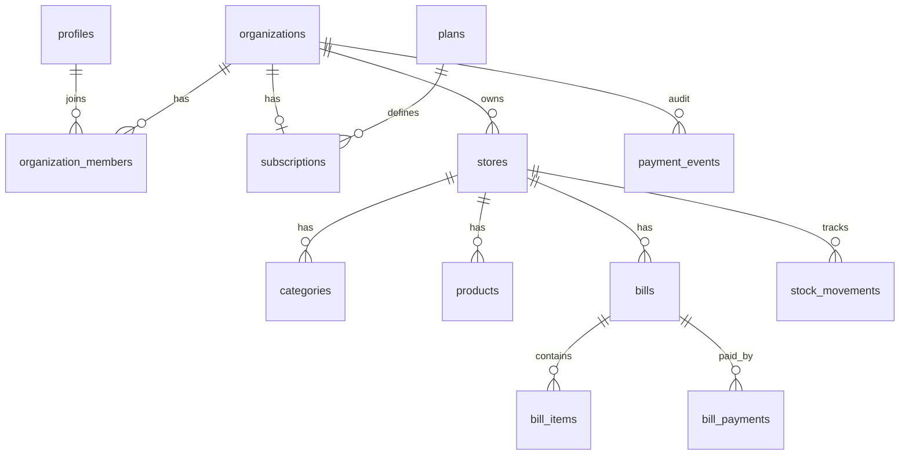
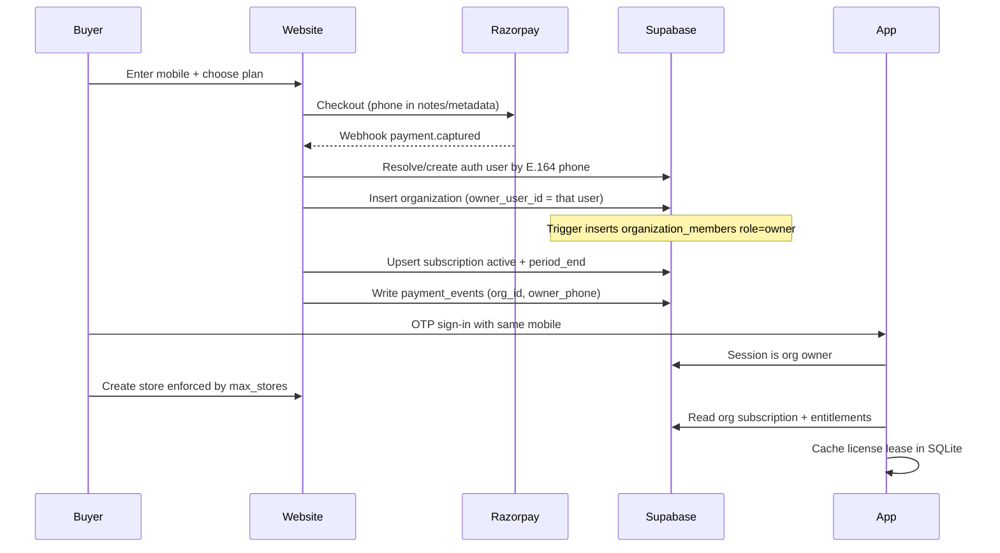

# Thuli Billings — Data Model

Living source of truth for multi-tenant schema, payment flow, and offline license lease.
Aligned with Supabase (`supabase/migrations/`) and SQLite (`app/src/db/`).

## Decisions

- **Subscription is organization-scoped** (not per store). Paying unlocks store creation and plan features for all stores under that org.
- **Owner = checkout mobile.** Website checkout requires a mobile number. After successful payment, that phone is the organization owner (`organizations.owner_user_id` → auth user for that E.164 phone). Clients do not create orgs.
- **Staff access** is org-wide via `organization_members` (any member can use any store; role gates actions). Owner membership is inserted by DB trigger on org create; further invites are owner/admin only.
- **Out of schema:** `customers`, `returns` / `return_items`, `store_members`, `printers` (printers stay device-local).
- **Bills** use optional free-text `customer_name` (no CRM table). `client_id` is a new UUID per sale, not the device install id.
- **Plans** are rows with entitlements; seed: `starter` / `growth` / `pro`.
- Naming: **`organizations`** maps to ARCHITECTURE “Tenant”.

## Entity map



## Payment → ownership → store creation



**Ownership rule:** the mobile entered at checkout is the sole initial owner. Website **writes** org + subscription + payment_events (service role). App **reads** status and caches a time-bounded lease for offline. Phone on `profiles` is unique (E.164) so webhooks can look up the owner.

---

## Supabase tables

### Auth / tenancy

| Table | Key fields |
| --- | --- |
| `profiles` | `id` (= `auth.users.id`), `full_name`, `phone` (unique E.164, must match `auth.users.phone`), `avatar_url`, timestamps |
| `organizations` | `id`, `name`, `owner_user_id` (user for checkout mobile), `closed_at`, `source_event_id`, timestamps |
| `organization_members` | `org_id`, `user_id`, `role` (`owner` \| `admin` \| `manager` \| `cashier`), unique `(org_id, user_id)` |
| `stores` | `org_id`, `name`, `phone`, `address`, `gstin`, `logo_url`, `is_active`, `timezone` |

### Billing (website-owned writes)

| Table | Key fields |
| --- | --- |
| `plans` | `code`, `name`, `price_paise`, `interval` (`month`/`year`), `blurb`, `recommended` (at most one), `is_active`, `sort_order` |
| `platform_admins` | operator email allowlist (`email` primary key, stored lowercase). No client read or write |
| `plan_entitlements` | `plan_id` (unique), `max_stores`, `max_staff`, `max_products` (null = unlimited), `analytics`, `invoices`, `priority_support` |
| `subscriptions` | one row per org (`org_id` unique): `plan_id`, `status`, period bounds, Razorpay ids |
| `payment_events` | webhook audit: `org_id`, `owner_phone` (checkout mobile), `event_type`, `razorpay_event_id` (unique), amounts, payload |

Subscription statuses: `trialing` | `active` | `past_due` | `canceled` | `expired`.

### POS / inventory (per store)

| Table | Key fields |
| --- | --- |
| `categories` | `store_id`, `name`, `sort_order` |
| `products` | `store_id`, `category_id?`, `name`, `sku?`, `barcode?` (unique per store when set), `unit`, cost/selling (tax-exclusive), `discount_percent`, `gst_percent`, `stock_qty` (cache of `stock_movements`), `is_active`, `revision` |
| `bills` | `store_id`, `bill_number`, `status`, `customer_name?`, money fields, seller snapshot, `billed_at`, `received_at`, `created_by`, `client_id` (per-sale idempotency UUID), `revision` |
| `bill_items` | `bill_id`, `product_id`, qty, prices, GST, line totals |
| `bill_payments` | `bill_id`, `mode` (`cash` \| `upi` \| `card` \| `other`), `amount`, `paid_at` |
| `stock_movements` | `store_id`, `product_id`, `delta`, `reason` (`sale` \| `adjust` \| `receive`), `ref_type`/`ref_id` |

Bill statuses: `draft` | `paid` | `pending` | `void`.

### Sync metadata

| Table | Purpose |
| --- | --- |
| `sync_tombstones` | Soft-delete propagation: `entity_type`, `entity_id`, `store_id` (required), `deleted_at` |

Mutable catalog and bill rows share `id` (uuid), `revision`, `created_at`, `updated_at`. Conflict policy: **compare-and-swap on `revision`**. `updated_at` is stamped by the server on update.

### RLS

- **Organizations** are created only by service role (payment webhook). No authenticated INSERT.
- Org create trigger inserts `organization_members` (`role = owner`) for `owner_user_id`.
- Org membership → SELECT org + all its stores. Staff invites: owner/admin only (`role <> owner`).
- Org UPDATE: owner only; `owner_user_id` immutable except service role.
- Org / account close: owner calls `delete_own_account()` — sets `organizations.closed_at`, redacts `payment_events` payloads, and leaves bills in place. The auth user stays because `owner_user_id` is `ON DELETE RESTRICT`. Closed orgs reject store, catalog, bill, and stock writes.
- **Role matrix (writes):**
  - owner/admin — stores, staff
  - owner/admin/manager — categories, products; delete bills / stock / tombstones
  - any member (incl. cashier) — bills, bill_items, bill_payments, stock_movements insert
- Helpers live in schema `private` (not PostgREST-exposed).
- `sync_tombstones.store_id` is required (no global null rows).
- Plan caps enforced by BEFORE INSERT triggers (`max_stores`, `max_staff`, `max_products`) when subscription is `trialing`/`active` and `current_period_end` is in the future. Counts lock the organization row. `max_staff` counts invitees (`role <> owner`).
- New bills are rejected unless `now()` is within `current_period_end + 7 days`. `received_at` is server time.
- Tombstone insert and update: owner/admin/manager. Cashiers can still insert bills and stock movements.
- Cross-store FKs: product↔category, stock↔product, bill_item↔product must share `store_id`. `store_id` cannot be changed after insert.
- `plans` / `plan_entitlements`: SELECT for authenticated. Anonymous SELECT is limited to active plans and their entitlements. Platform admins may UPDATE both. `code` and `interval` cannot change. No client insert or delete of plans.
- `platform_admins`: operator emails only. `am_platform_admin()` is true when the session has a Google identity whose email is on that list. A phone session does not qualify. `platform_snapshot()` returns operator analytics and refuses everyone else.
- Platform admins may SELECT all organizations, profiles, members, subscriptions, stores, and payment events. They cannot change customer rows. Bill rows stay inside `platform_snapshot()`; there is no client SELECT policy on bills for operators.
- `subscriptions`: member SELECT; `payment_events`: owner/admin SELECT; writes service role only.
- Client roles: `SELECT/INSERT/UPDATE/DELETE` only (no `TRUNCATE`).

---

## SQLite (local POS)

Mirror for the active org’s stores:

- `local_meta` — `active_org_id`, `active_store_id`, `last_pull_at`
- `license_lease` — cached subscription snapshot
- Domain mirrors: `organizations`, `stores`, `categories`, `products`, `bills`, `bill_items`, `bill_payments`, `stock_movements`
- `sync_queue` — pending upserts/deletes

Do **not** store Razorpay secrets or raw webhook payloads locally.

---

## Offline license lease

Disconnecting forever must not equal free forever.

1. On successful auth/sync, cache: `status`, plan code, entitlements, `current_period_end`, and `lease_expires_at = now + 7 days`.
2. Persist in `license_lease` with `server_time_at_issue` and `device_time_at_issue`.
3. **POS gate:**
   - Online: refresh lease from Supabase.
   - Offline + within lease + status `active|trialing`: allow checkout.
   - Offline past lease: **block new bills** (history/stock read-only); prompt to connect / pay on website.
4. **Clock rollback:** if device time &lt; `device_time_at_issue` − 1h skew → force online revalidation.
5. Online: inactive / past `current_period_end` → gate features and block store create.
6. Plan limits enforced server-side on store create / staff invite; app mirrors for UX.

```text
Online refresh → write lease (7d) → offline POS until lease_expires_at
Past lease / expired sub → no new bills until online proof of active sub
```

---

## Placeholder plan entitlements

| Entitlement | starter | growth | pro |
| --- | --- | --- | --- |
| max_stores | 1 | 3 | 10 |
| max_staff | 2 | 10 | 50 |
| max_products | 50 | 200 | unlimited (`null`) |
| analytics | no | yes | yes |
| invoices | no | yes | yes |
| priority_support | no | no | yes |

Adjust via data, not migrations.

## Related files

- Supabase: [`supabase/migrations/0001_init.sql`](../supabase/migrations/0001_init.sql), [`supabase/migrations/20260921170522_owner_phone_on_payment.sql`](../supabase/migrations/20260921170522_owner_phone_on_payment.sql), [`supabase/migrations/20260921170818_rls_hardening.sql`](../supabase/migrations/20260921170818_rls_hardening.sql), [`supabase/migrations/20260921172120_delete_own_account.sql`](../supabase/migrations/20260921172120_delete_own_account.sql), [`supabase/migrations/20260921172526_delete_own_account_private.sql`](../supabase/migrations/20260921172526_delete_own_account_private.sql), [`supabase/migrations/20261003141500_pos_integrity.sql`](../supabase/migrations/20261003141500_pos_integrity.sql), [`supabase/migrations/20261016213000_platform_admin.sql`](../supabase/migrations/20261016213000_platform_admin.sql)
- Types: [`app/src/types/`](../app/src/types/)
- SQLite: [`app/src/db/schema.ts`](../app/src/db/schema.ts)
- Architecture: [`ARCHITECTURE.md`](../ARCHITECTURE.md)
